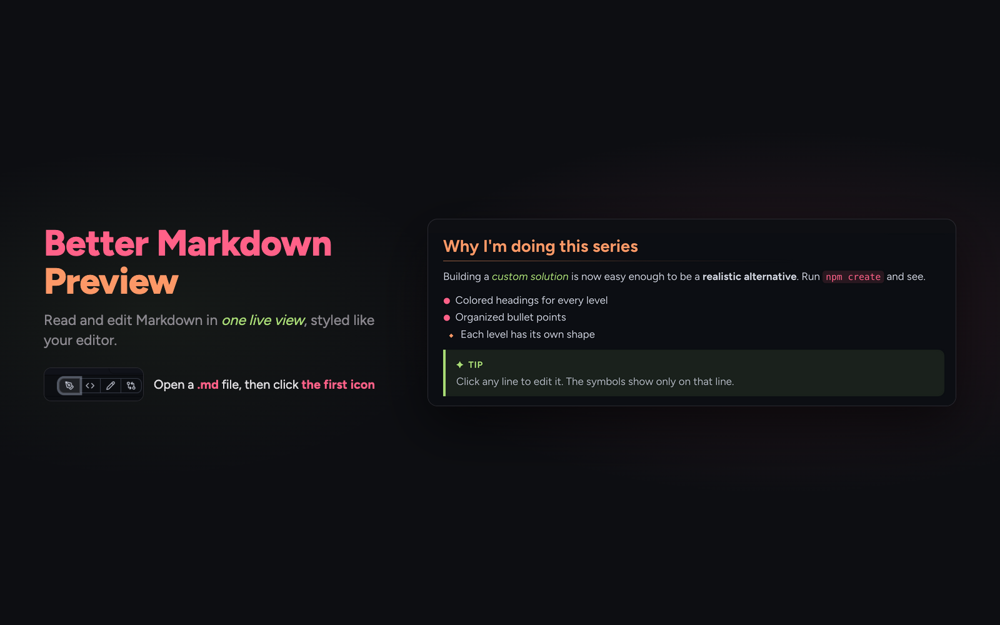
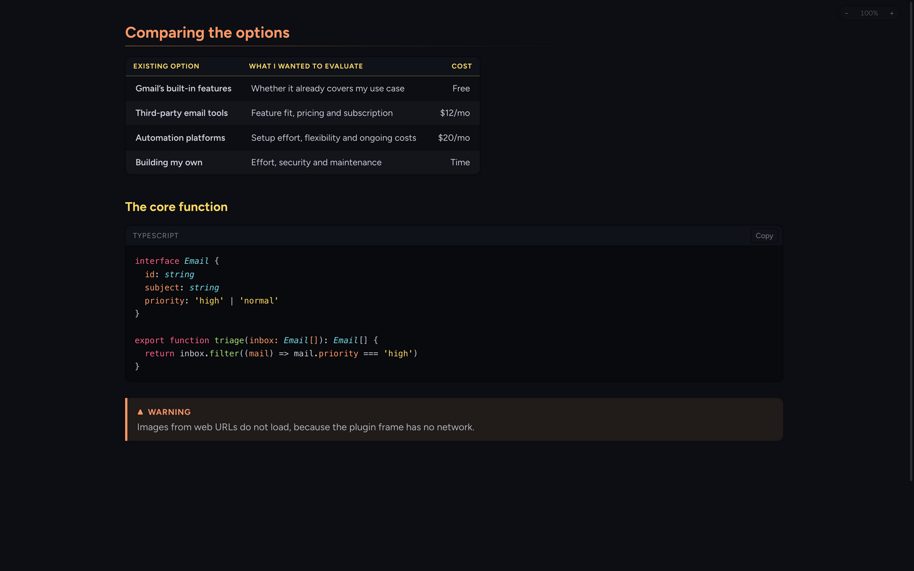
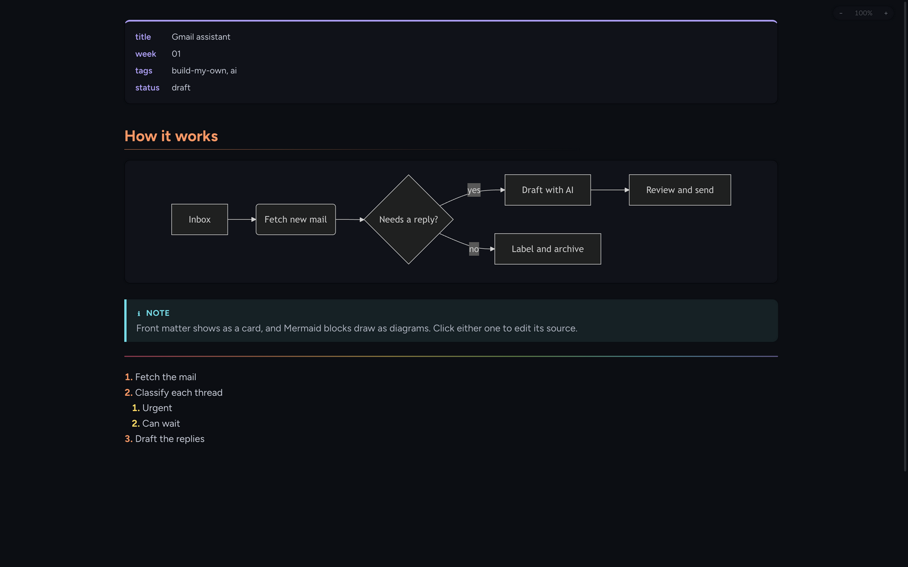
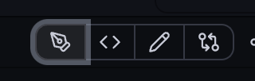

# Better Markdown Preview

Read and edit Markdown in one view inside [Orca](https://github.com/stablyai/orca). The Markdown symbols hide until you edit a line, so a note reads like a finished page and stays editable.



## Features

- **Colored headings.** H1 to H6 each have their own Monokai color, and H1 and H2 have a fading underline.
- **Organized lists.** Each nesting level has its own bullet shape and color. Numbered lists have colored numbers.
- **Task lists.** Click a checkbox to tick a task. Finished tasks are crossed out.
- **Clean tables.** A compact header, a bold key column and striped rows. A table is only as wide as its content.
- **Code blocks.** Syntax colors, a language label and a copy button.
- **Callouts.** GitHub callouts: `> [!NOTE]`, `[!TIP]`, `[!IMPORTANT]`, `[!WARNING]` and `[!CAUTION]`.
- **Front matter.** YAML front matter shows as a card.
- **Mermaid.** ` ```mermaid ` blocks draw as diagrams.
- **Live editing.** Type anywhere. Click a table, code block, diagram or front matter card to edit its source.
- **Zoom.** Use the `− 100% +` control in the top right corner, or pinch on the trackpad.
- **Readable type.** Body text uses the Figtree font, included in the plugin.





## Install

1. In Orca, open **Settings**, then **Plugins**.
2. Search for **Better Markdown Preview** and install it.
3. Open a `.md`, `.markdown` or `.mdx` file.
4. In the view toggle at the top right of the editor, click the **first icon** (the pen nib). Its tooltip says **Preview**.

   

   The other icons are Orca's own views. `<>` is Source, and the pencil is Orca's rich editor.

Orca opens Markdown files in Source first, and a plugin cannot change that. Click the first icon each time you open a file.

## Use

| Action | How |
| --- | --- |
| Open the preview | Click the first icon (the pen nib) in the editor's view toggle. |
| Edit a line | Click it. Its Markdown symbols show while the cursor is on it. |
| Edit a table, code block or diagram | Click it. It changes to its source until the cursor leaves it. |
| Tick a task | Click its checkbox. |
| Open a link | `Cmd`-click it. A normal click puts the cursor in it. |
| Zoom | Click `−` or `+`, or pinch. Click the percentage to reset. |
| Undo | `Cmd Z` |
| Save | Orca's usual save shortcut. |

## Limits

- **Zoom keys.** Orca keeps `Cmd +` and `Cmd -` for its own window, so they do not zoom the preview. Use the zoom control or a pinch.
- **No network.** Orca runs plugins without network access. Images from web URLs do not load.
- **No raw HTML.** HTML in the Markdown shows as text.
- **Agent edits.** When an agent writes the file while you type, the preview keeps both changes if they touch different lines. If both change the same lines, the agent's version wins.

## What's new in 1.0.1

- The plugin page now says how to open the preview: click the first icon in the view toggle.
- A new cover that fits the wide crop on the plugin page.

## What's new in 1.0.0

- First release.

## Develop

```sh
orca plugin check .
orca plugin dev load "$PWD"
orca plugin shot local.better-markdown-preview --editor "$PWD/samples/tables.md" --width 1600 --height 1000
```

`editor/main.ts` starts the editor, keeps the file in sync with Orca and owns the zoom control. `editor/live.ts` decides which parts of the document show rendered and which show as Markdown. `editor/render.ts` draws tables, code blocks, front matter and diagrams. `editor/merge.ts` combines your edits with outside changes. `editor/reader.css` holds every color and size.

`lib/` holds markdown-it 14.1.0, highlight.js 11.11.1, Mermaid 11.4.1 and a CodeMirror 6 bundle. Run `scripts/build-codemirror.sh` to rebuild `lib/codemirror.mjs` from `scripts/codemirror-entry.js`.

## License

MIT. The bundled libraries and the Figtree font keep their own licenses, listed in [THIRD-PARTY-NOTICES.md](THIRD-PARTY-NOTICES.md).
