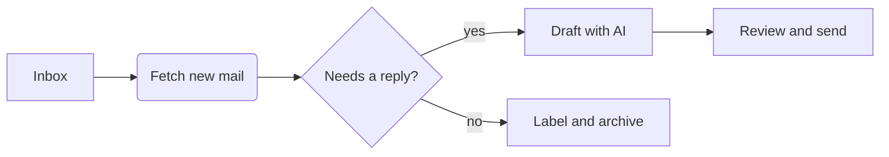

## How it works

> [!NOTE]
> Front matter shows as a card, and Mermaid blocks draw as diagrams. Click either one to edit its source.

---

1. Fetch the mail
2. Classify each thread
   1. Urgent
   2. Can wait
3. Draft the replies
