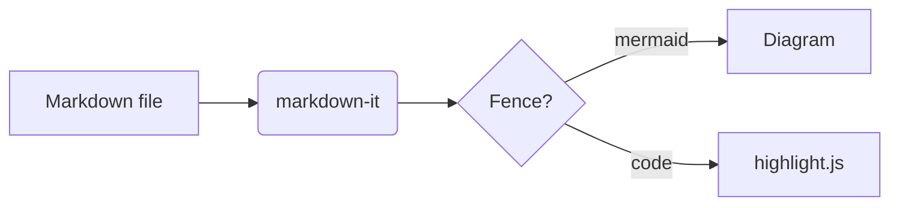

##### Code

```typescript
interface User {
  id: number
  name: string
}

export function greet(user: User): string {
  return `Hello, ${user.name}!`
}
```

```python
def add(a: int, b: int) -> int:
    return a + b  # simple sum
```

###### Callouts

> [!NOTE]
> Orca opens `.md` files in Source first. Click **Reader** in the view toggle.

> [!TIP]
> Edit the file in Source. The Reader view updates live.

> [!WARNING]
> Images from web URLs do not load, because the sandbox has no network.

> [!CAUTION]
> Raw HTML in the Markdown shows as text.

> A plain quote stays a plain quote.

---

## Diagram


