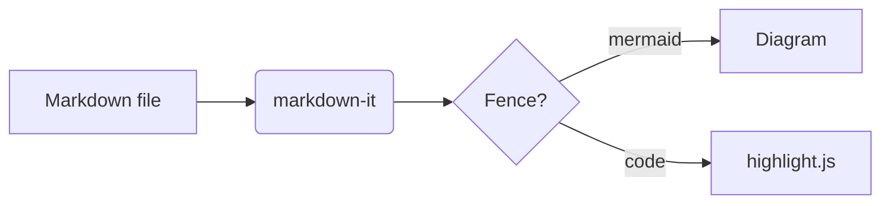

# Project Overview

This is a **reading view** for Markdown. It shows *italic text*, ***bold italic***, ~~strike~~ and `inline code`. Links like https://github.com open in the browser.

## Features

- Colored headings for each level
- Organized bullet points
  - Second level uses a diamond
    - Third level uses an arrow
      - Fourth level uses a dash
- Styled tables

1. First step
2. Second step
   1. Nested step
   2. Another nested step

### Task list

- [x] Parse front matter
- [x] Highlight code
- [ ] Ship version 1.0

#### Table

| Feature | Status | Notes |
| --- | :---: | --- |
| Headings | Done | Six colors |
| Lists | Done | Four bullet shapes |
| Tables | Done | Striped rows |
| Mermaid | Done | Loaded on demand |

##### Code

```typescript
interface User {
  id: number
  name: string
}

export function greet(user: User): string {
  return `Hello, ${user.name}!`
}
```

```python
def add(a: int, b: int) -> int:
    return a + b  # simple sum
```

###### Callouts

> [!NOTE]
> Orca opens `.md` files in Source first. Click **Reader** in the view toggle.

> [!TIP]
> Edit the file in Source. The Reader view updates live.

> [!WARNING]
> Images from web URLs do not load, because the sandbox has no network.

> [!CAUTION]
> Raw HTML in the Markdown shows as text.

> A plain quote stays a plain quote.

---

## Diagram


